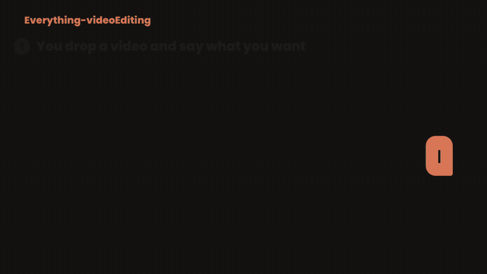
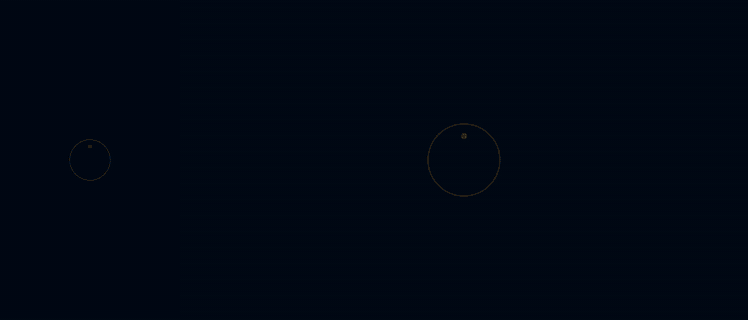

<div align="center">


**Give your AI agent a video and one sentence. Get back a finished, platform-ready edit.**

<p>


</p>



</div>

## What it does

Everything-videoEditing is an [Agent Skill](https://agentskills.io): a folder of instructions
and scripts that turns Claude Code, OpenAI Codex, Gemini CLI (or any agent with a shell) into a
video editor. It runs locally on your machine with open-source tools.

1. **You** drop footage and say what you want ("make this a Reel with captions and music").
2. **It analyses** the video: speech and language, pauses and "um"s, noise, music under the
   voice, faces, shaky shots, exposure, length, orientation.
3. **It asks you** 2-4 multiple-choice questions built from that analysis (platform, length,
   style, captions...), recommended option first.
4. **It edits**: cuts, reframes, grades, captions, mixes, adds graphics, renders a draft, shows
   you, asks what to change, and loops.
5. **You get** every version: Reels/Shorts/TikTok 9:16, YouTube 16:9, feed 4:5, plus an `.srt`
   file, a thumbnail, and a title/description/hashtags.

## Features

| | |
|---|---|
| **Cut** | jump cuts that remove pauses, "um/uh" and retakes (Whisper word timings), trim, speed ramps, slow-mo, freeze frames, beat-synced montages, highlight reels from loud moments |
| **Frame** | face-aware vertical reframing, blurred fill, punch-in zooms, Ken Burns on photos, 30 transitions, stabilisation, letterbox, split screen, picture-in-picture, green screen, blur/pixelate faces or plates |
| **Look** | 17 colour grades (cinematic, teal-orange, golden, moody, film, B&W...), auto exposure/white-balance fix, LUTs, grain, vignette |
| **Text** | word-by-word captions (pop, bold, karaoke, boxed, clean) with **correct Bangla shaping**, hook titles, lower thirds, price tags, CTAs, legal lines, all kept inside each platform's safe zone |
| **Sound** | voice clean-up (RNNoise), voice isolation / music removal (Demucs), music found by description in your own library (CLAP), generated music beds and SFX, auto-ducking, bleeps, -14 LUFS loudness |
| **Graphics** | Remotion motion graphics: title cards, lower thirds, subscribe/follow, end cards, kinetic text, counters, logo reveal, end slate/packshot, offer badge, before/after, feature callouts, animated wordmark; Blender 3D titles |
| **Voice** | text-to-speech voice-over with word timings (Bangla and English neural voices) |
| **Ads / OVC** | brand kit + scene script → voice-over, supers, badges, end slate, music, **60/30/15/6 s versions × 16:9/9:16/4:5**, client storyboard |
| **Everyday** | compress to a size (WhatsApp/email), GIF, convert, extract audio, rotate, reverse, boomerang, merge, loop, stills, split by scene, restore old/family videos, add subtitles, photo slideshows |
| **Platforms** | Facebook, Instagram, YouTube, TikTok, LinkedIn, X, WhatsApp Status, TV: sizes, safe zones, length limits, thumbnail sizes, `--variants` export |

## Ads / OVC example

<div align="center">

</div>

A 15 s offer ad built by `ovc_build.py` from [`examples/script_ovc.json`](examples/script_ovc.json):
logo reveal, Bangla supers and captions, offer badge, feature callouts, end slate with contact
and legal line, music bed. One run renders Reels 9:16, YouTube 16:9 and feed 4:5, plus a
[client storyboard](docs/storyboard_example.html). (The footage here is generated; use your own shots.)

## Install

```bash
git clone https://github.com/CodeWithYeasin/everything-video-editing
cd everything-video-editing
```

**Windows** (PowerShell, no admin):
```powershell
powershell -ExecutionPolicy Bypass -File install.ps1 -Tools            # skill + tools + models
powershell -ExecutionPolicy Bypass -File install.ps1 -Tools -Root D:\video-tools
```

**Linux / macOS**:
```bash
bash install.sh --tools
```

`install` links the skill into `~/.claude/skills`, `~/.codex/skills` and `~/.gemini/skills`.
`--tools` installs FFmpeg 9, a Python 3.11 environment (Whisper, Demucs, CLAP, OpenCV, librosa,
edge-tts), Blender 4.5 LTS and downloads the AI models (about 3-5 GB). Remotion needs
[Node.js 18+](https://nodejs.org). Check anytime with
`python skills/everything-video-editing/scripts/doctor.py`.

### Per agent

| Agent | How it loads |
|---|---|
| **Claude Code** | `~/.claude/skills/everything-video-editing` (installer), or as a plugin: `/plugin marketplace add CodeWithYeasin/everything-video-editing` then `/plugin install everything-video-editing@everything-video-editing` |
| **Claude apps** | upload `skills/everything-video-editing` as a zip in Settings → Capabilities → Skills; link your computer so it can run the tools there |
| **OpenAI Codex** | `~/.codex/skills/everything-video-editing` (installer); inside this repo `AGENTS.md` points Codex to the skill |
| **Gemini CLI** | `~/.gemini/skills/everything-video-editing` (enable Agent Skills in `/settings`), or `gemini extensions install <repo path>` (uses `GEMINI.md`) |
| **Any other agent** | point it at `skills/everything-video-editing/SKILL.md` |

## Try it

```text
এই ভিডিওটা Reels বানাও, বাংলা captions আর হালকা music দাও
Edit raw.mp4 for YouTube and also give me a 45 s Short from the best part
Remove my ums and pauses, clean the noise, add my name as a lower third
Make a 30 s + 15 s + 6 s Eid offer ad for my tea brand from these photos (logo attached)
Turn this folder of photos into a birthday slideshow with music
Compress this to 16 MB so I can send it on WhatsApp
Restore this old wedding tape and make a 3-minute highlight film
```

## How it works

```
your footage ─► analyze.py ─► questions ─► plan.json ─► render.py ─► draft ─► feedback ─► final × platforms
                 (Whisper, CLAP,              │            (FFmpeg: cuts, grade, captions,
                  OpenCV, FFmpeg)             │             overlays, audio mix, loudness)
                                              ├─ transcribe.py / cutlist.py   (Whisper)
                                              ├─ separate.py                  (Demucs)
                                              ├─ clap_rank.py                 (CLAP)
                                              ├─ remotion_gfx.py              (Remotion)
                                              ├─ title3d.py                   (Blender)
                                              └─ tts.py / ovc_build.py        (voice-over, ads)
```

Everything is driven by a small JSON edit plan, so every change is a one-line edit and a fast
re-render (the cut is cached). Full reference: [`plan_format.md`](skills/everything-video-editing/references/plan_format.md).

<details>
<summary><b>Scripts</b></summary>

| script | job |
|---|---|
| `analyze.py` | findings + question rounds with options |
| `probe.py` | facts, loudness, pauses, scene cuts, colour hints, contact sheet |
| `transcribe.py` | speech to text with word timings, `.srt` |
| `cutlist.py` | jump-cut clip list from words or silence |
| `render.py` | the engine: plan.json → video, `--variants`, `--draft` |
| `platforms.py` / `safezone.py` | platform presets / UI safe-zone check image |
| `remotion_gfx.py` | 15 motion-graphic templates, brand-aware |
| `title3d.py` | Blender 3D title |
| `tts.py` | voice-over with word timings |
| `ovc_build.py` | ads from a scene script, versions × aspects, storyboard |
| `separate.py` | Demucs stems |
| `clap_rank.py` | find music/SFX by description |
| `analyze_audio.py` | beats, loudest moments |
| `sfx_synth.py` | SFX pack + music beds |
| `thumbnail.py` | thumbnail / cover |
| `quick.py` | 20 one-command everyday edits |
| `doctor.py` | install check |
</details>

<details>
<summary><b>Speed on a modest PC</b> (Ryzen 3, 8 GB RAM, GT 1030, CPU only)</summary>

Render ~30 s per 10 s of 1080x1920 · Whisper medium ≈ real time (+ model load) · Demucs ≈ 3×
faster than real time · CLAP 20 s for 16 files · Remotion ~1.5 min per 3 s graphic ·
Blender EEVEE ~10 s per 1080p frame. A GPU makes Whisper, Demucs and Blender much faster.
</details>

## Credits and licenses

MIT for this repository. It installs and calls: [FFmpeg](https://ffmpeg.org) (LGPL/GPL),
[Whisper](https://github.com/openai/whisper) and
[faster-whisper](https://github.com/SYSTRAN/faster-whisper) (MIT),
[Demucs](https://github.com/facebookresearch/demucs) (MIT),
[LAION CLAP](https://github.com/LAION-AI/CLAP) (CC0/Apache), [Blender](https://blender.org) (GPL),
[Remotion](https://remotion.dev) (free for individuals and small teams; larger companies need a
[company license](https://remotion.pro)), [edge-tts](https://github.com/rany2/edge-tts) (uses
Microsoft's online voices: check their terms for paid commercial work), RNNoise models,
and Google Fonts under the SIL OFL. Use only footage and music you have the rights to.
